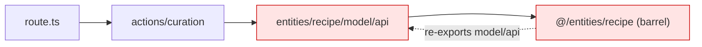
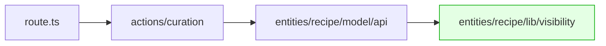

어제까지 문제없이 잘 돌아가던 큐레이션 생성 API가 갑자기 500 에러를 뱉기 시작했어요. 라우트 컴파일은 정상적으로 끝나는데 정작 응답이 오지 않는 기묘한 상황이었죠. 원인을 파고들어 가 보니 `entities/recipe`의 `index.ts` 한 줄이 문제였어요. 슬라이스 내부에서 자기 자신의 배럴 파일을 불러오는 self-barrel import 한 줄이 어떻게 Turbopack 워커를 무너뜨렸는지, 그리고 앞으로 같은 함정에 빠지지 않으려고 어떤 안전장치를 마련했는지 정리해 볼게요.

결과만 먼저 말씀드리면 해결책 자체는 아주 단순한 한 줄 수정이었어요. `@/entities/recipe`로 되어 있던 경로를 `@/entities/recipe/lib/visibility`로 바꾼 게 전부였거든요. 하지만 이 한 줄을 찾아내기까지 개발 서버를 11번이나 다시 띄워야 했고, 그 과정에서 똑같은 패턴이 프로젝트 안에 5곳이나 더 숨어 있다는 사실도 발견하게 되었어요.

## FSD 구조에서 슬라이스 배럴 파일을 활용해 온 방식

Feature-Sliced Design(FSD) 아키텍처를 도입한 프로젝트라면 각 슬라이스(예: `entities/recipe`, `features/recipe-create`) 루트에 `index.ts` 같은 배럴 파일을 두는 방식이 꽤 익숙하실 거예요. 슬라이스 바깥에서는 그 슬라이스가 외부에 공개한 API만 바라보면 되니까 import 경로가 깔끔해지고, 슬라이스 내부 구조를 어떻게 뜯어고치더라도 외부의 import 경로는 건드릴 필요가 없다는 장점이 있거든요.

저희 프로젝트에서도 바로 이 패턴을 표준으로 삼아 쓰고 있었어요.

```ts
// src/entities/recipe/index.ts
export * from "./model/api";
export { ensureSource, isPrivateRecipe } from "./lib/visibility";
export type { Recipe, RecipeStep } from "./model/types";
```

이렇게 구성해 두면 페이지나 다른 슬라이스에서는 고민할 것 없이 `@/entities/recipe` 경로 하나로 필요한 모듈을 깔끔하게 가져올 수 있어요. 팀원 모두가 자연스럽게 받아들이고 쓰던 익숙한 방식이었죠.

## 큐레이션 생성 API에서 발생한 의문의 500 에러와 Rust 패닉

그런데 어느 날 어드민 페이지에서 큐레이션을 생성하는 기능이 갑자기 500 에러를 내기 시작했어요. 개발 서버 콘솔을 확인해 보니 딱 이런 로그만 덩그러니 찍혀 있었어요.

```
thread 'tokio-runtime-worker' panicked at crates\next-api\src\dynamic_imports.rs:70:26:
called `Option::unwrap()` on a `None` value
note: run with `RUST_BACKTRACE=1` environment variable to display a backtrace
 ✓ Compiled /api/admin/curation/generate in 686ms
 POST /api/admin/curation/generate 500 in 1915ms
```

상황이 정말 이상했어요. 분명 `✓ Compiled`라고 뜨면서 라우트 컴파일은 성공했는데, 요청을 보내면 어김없이 500 에러가 돌아왔거든요. 라우트 핸들러 함수 첫 줄에 `console.error`를 찍어봐도 콘솔에는 아무것도 남지 않았어요. 자바스크립트 런타임 코드가 아예 실행되기도 전 단계에서 무언가가 터져버린 셈이었죠.

게다가 더 의아했던 점은, 같은 프로젝트 안에 있는 `/api/recipes`나 `/api/search` 같은 다른 API 라우트들은 모두 멀쩡하게 돌아가고 있었다는 사실이에요. 유독 이 큐레이션 생성 라우트 하나만 죽어버린 상태였어요.

## Turbopack 자체 버그를 의심하며 마주한 선택지

로그에 찍힌 `dynamic_imports.rs:70`이라는 파일 경로와 `Option::unwrap()` on `None`이라는 문구를 보면, 누가 봐도 Rust로 작성된 Turbopack 내부에서 패닉이 발생한 모습이었어요. 실제로 Next.js 깃허브 저장소 이슈 탭을 뒤져보니 비슷한 패닉 리포트가 여럿 올라와 있었고, 대부분 최신 버전에서 수정되었다는 코멘트가 달려 있더라고요. 저희 프로젝트는 당시 Next.js 15.3.8 버전을 쓰고 있었는데, 15.5 버전 정도로 올리면 해결된다는 이야기도 보였어요.

그 순간 갈림길에 서게 되었어요. **프레임워크 버전을 올려서 넘어가 볼까, 아니면 원인을 더 파고들어 볼까.**

버전업에 따르는 비용을 빠르게 따져보았어요. App Router 내부 동작의 미세한 변화, React Compiler와의 호환성, server actions 시그니처 변경 등 자칫 잘못 건드리면 프로젝트의 다른 영역까지 연쇄적으로 깨질 위험이 있었거든요. 무엇보다도 버전을 올린다고 해서 "왜 하필 우리 프로젝트의 이 라우트에서만 터지는가"에 대한 근본적인 답을 얻을 수는 없었어요. 동일한 Turbopack 환경에서 다른 라우트들은 멀쩡한데 이 라우트만 죽는다면, 우리 코드 베이스 어딘가에 이 패닉을 촉발하는 트리거가 숨어 있다는 뜻이니까요. 깃허브에 같은 패닉 이슈가 보고되어 있다는 사실이 우리 코드의 트리거 가능성을 부정해 주지는 못하니까요.

결국 원인을 끝까지 파헤쳐 보기로 결정했어요.

## 이진 탐색으로 모듈 의존성을 격리하며 원인 좁히기

문제를 격리하기 위해 가장 먼저 `route.ts` 파일의 내용을 텅 빈 핸들러 수준으로 비워보았어요.

```ts
import { type NextRequest, NextResponse } from "next/server";

export async function POST(_req: NextRequest) {
  return NextResponse.json({ diag: "empty" });
}
```

이렇게 바꾸자 패닉이 사라지고 정상적으로 200 응답이 돌아왔어요. 이로써 **핸들러가 끌어오는 import 그래프 어딘가에 트리거가 숨어 있다**는 점을 확실히 알 수 있었죠.

이제 원래 핸들러가 가지고 있던 import 문을 한 줄씩 다시 추가하면서 어느 지점에서 패닉이 재발하는지 확인해 나갔어요. 원래 라우트 핸들러가 추가로 불러오던 의존성은 다음 세 줄이었어요.

```ts
import { CurationError, type GenerateCurationInput } from "@/entities/curation";
import { generateCuration } from "@/app/actions/curation";
import { assertAdminApi } from "@/shared/lib/admin-guard";
```

가장 방대한 의존성 그래프를 품고 있는 `@/app/actions/curation`부터 다시 붙여보았어요. 그러자 곧바로 **패닉이 다시 발생**했어요. 이 액션 그래프 내부에 범인이 있다는 뜻이었죠. 그 안에는 ai-sdk, zod, entities, shared를 비롯해 `app/admin/curation-test/lib/*` 하위 모듈 9개까지 수많은 import가 얽혀 있었어요.

모듈들을 하나씩 떼어내며 단독으로 테스트를 이어갔어요.

- `@ai-sdk/openai` + `ai`만 포함: 통과
- `@/app/admin/curation-test/lib/slugify`만 포함: 통과
- `"use server"` + `@/shared/lib/admin-guard`: 통과
- `"use server"` + `@/entities/recipe/model/api`: **패닉 발생.**

`getRecipe` 함수를 가져오는 순간 어김없이 서버가 죽어버렸어요. 그래서 해당 모듈 파일을 열어 코드를 찬찬히 살펴보았어요.

```ts
// src/entities/recipe/model/api.ts
import { ensureSource } from "@/entities/recipe";  // ← 이 한 줄
import { END_POINTS } from "@/shared/config/constants/api";
// ...

export const getRecipe = async (id: string) => {
  const r = await api.get<Recipe>(END_POINTS.RECIPE(id));
  return r;
};
```

`api.ts` 내부에서 `@/entities/recipe`를 import하고 있었어요. 바로 자기가 속해 있는 슬라이스의 최상위 배럴 파일이었죠. 그리고 그 배럴 파일(`index.ts`)은 이렇게 작성되어 있었어요.

```ts
export * from "./model/api";  // ← api.ts 자기 자신을 re-export
```

결국 슬라이스 내부의 파일이 자기 슬라이스의 배럴을 바라보고, 그 배럴이 다시 자기 자신을 re-export하면서 스스로를 순환 참조하는 cycle이 완성되어 있던 거예요.

## self-barrel 순환 참조를 직접 경로로 교체해 해결한 과정

의존 경로를 배럴이 아닌 구체적인 내부 파일 경로로 직접 지정해 주었어요.

```diff
- import { ensureSource } from "@/entities/recipe";
+ import { ensureSource } from "@/entities/recipe/lib/visibility";
```

이렇게 바꾸자마자 거짓말처럼 패닉이 사라졌어요. 11번의 격리 테스트를 거친 끝에, 단 한 줄의 경로 수정으로 문제를 온전히 해결할 수 있었어요.

## 의존성 그래프로 살펴보는 순환 참조와 수정 결과

문제가 되었던 의존성 그래프의 흐름을 다이어그램으로 나타내면 다음과 같아요.



`api.ts`가 자기가 속한 슬라이스의 배럴 파일을 import하고, 배럴 파일은 다시 `api.ts`를 export하면서 self-cycle을 형성하고 있었던 거죠. 수정한 후의 의존성 흐름은 다음과 같이 단순해졌어요.



이제 자기 자신으로 되돌아오는 순환 고리가 완전히 끊어졌어요.

## 원인을 파악하기 까다로웠던 세 가지 이유

이번 장애는 디버깅 과정에서 원인을 짚어내기가 특히 까다로웠는데, 세 가지 악조건이 맞물려 있었기 때문이에요.

첫째, **에러 메시지가 우리 애플리케이션 코드를 전혀 가리키지 않았어요.** 로그에 남은 `crates/next-api/src/dynamic_imports.rs:70`이라는 위치는 Next.js 내부 Rust 엔진의 소스 코드 경로예요. 우리 프로젝트 코드 중 어느 파일, 어느 줄이 꼬여서 발생했는지 힌트를 한 글자도 주지 않았죠.

둘째, **`console.error`조차 동작하지 않았어요.** Turbopack 워커 스레드가 라우트 모듈을 분석하고 빌드하는 과정에서 죽어버렸기 때문에, 우리가 작성한 자바스크립트 런타임 코드는 단 한 줄도 실행 기회를 얻지 못했어요. try-catch 문도, 로깅도, Sentry의 breadcrumb 기록도 모두 무용지물이었던 셈이에요.

셋째, **문제의 코드가 이미 조용히 잠복해 있던 상태였어요.** 이 순환 참조 자체는 며칠 전 커밋에서 이미 만들어져 있었어요. 다만 단건 생성 작업은 서버 액션을 직접 호출하는 구조라 라우트 핸들러가 컴파일될 일이 없었고, 배치 생성 작업 역시 개발 환경에서 직접 눌러보지 않았던 터였죠. 그러다 오늘 처음으로 해당 라우트에 요청이 들어오면서 첫 컴파일이 시도되었고, 그제야 패닉이 수면 위로 드러난 거예요. "어제까지는 분명 아무 문제 없었는데"라는 생각에 사로잡힐수록 문제의 원인을 짚어내기가 훨씬 더 어려워지는 구조였어요.

돌아보면 조금 더 영리하게 대처할 방법도 있었어요. 애초에 `RUST_BACKTRACE=1` 환경 변수를 주고 개발 서버를 띄웠다면 Turbopack 내부 어느 단계에서 unwrap 패닉이 터졌는지 더 일찍 단서를 잡았을지도 몰라요. 혹은 `eslint-plugin-import`의 `no-cycle` 룰을 활성화해 두었다면 커밋하는 시점에 바로 걸러졌을 테고요. 다만 `no-cycle` 규칙은 전체 import 그래프를 깊게 탐색하느라 린트 속도를 크게 떨어뜨리는 것으로 악명 높아서 도입을 미뤄두고 있었는데, 그 대가를 이번에 톡톡히 치른 셈이 되었어요.

## 프로젝트 내 숨어 있던 5개의 잠재적 순환 참조 탐색

혹시 프로젝트 안에 이런 위험한 패턴이 더 숨어 있지 않을까 걱정이 되어 간단한 grep 검사 스크립트를 작성해 돌려보았어요.

```js
// scripts/find-self-barrel.mjs
const layers = ["entities", "features", "widgets"];
for (const layer of layers) {
  for (const slice of readdirSync(`src/${layer}`)) {
    const barrel = `@/${layer}/${slice}`;
    walk(`src/${layer}/${slice}`, (file) => {
      // file 안에 `from "${barrel}"` 가 정확 매칭으로 있는지
    });
  }
}
```

스크립트를 돌려본 결과, 놀랍게도 **5개 파일**이 추가로 잡혔어요. 방금 수정한 `entities/recipe/model/api.ts`까지 합치면 총 6곳에 같은 패턴이 존재했던 거예요.

| 파일 | 노출 그래프 |
|---|---|
| `entities/recipe/model/api.ts` | route-handler + server-action ← 터진 곳 |
| `entities/recipe/ui/RecipeStepList.tsx` | page graph |
| `features/comment-like/model/hooks.ts` | page graph |
| `features/comment-like/ui/CommentLikeButton.tsx` | page graph |
| `features/ingredient-add-fridge/ui/IngredientSearchDrawer.tsx` | page graph |
| `features/recipe-create/ui/RecipeFormLayout.tsx` | page graph |

순환 참조 구조를 가진 파일은 총 6개였지만, 실제로 터진 곳은 단 1곳이었고 나머지 5개는 조용히 숨어 있었어요. 만약 누군가가 저 5개 모듈 중 하나라도 라우트 핸들러, 서버 액션, instrumentation 같은 server-only 컨텍스트로 끌어오는 순간 똑같은 패닉이 그대로 재현될 잠재적 시한폭탄들이었던 셈이에요.

## 페이지 그래프에서는 넘어가고 라우트 핸들러에서만 터진 배경

Next.js는 프로젝트를 빌드할 때 단일 모듈 그래프 하나만 만들지 않아요. 일반 페이지용, 라우트 핸들러용, server-actions registry용, 미들웨어용 등 목적에 따라 여러 개의 그래프를 독립적으로 구성하고 각각 서로 다른 분석 패스를 적용해요. 순환 구조 자체는 모든 그래프에서 형성되었겠지만, 페이지용 모듈 그래프의 경우 순환을 우회할 수 있는 다양한 탐색 경로가 열려 있어서 Turbopack이 별다른 탈 없이 빌드를 마칠 수 있었어요.

반면 라우트 핸들러나 server-actions registry 그래프는 `dynamic_imports.rs`라는 훨씬 엄격한 전용 분석기를 추가로 거치게 돼요. 이 과정에서 module map lookup 결과로 None이 반환되었는데, 내부 코드가 거기에 무조건 `.unwrap()`을 호출해 버리면서 워커 스레드가 패닉을 일으킨 것이죠. 결국 Next.js는 모듈을 정상 생성하지 못하고 클라이언트에 500 에러를 내려보내게 된 거고요.

같은 순환 구조를 품고 있는 코드라도 어떤 모듈 그래프에 포함되느냐에 따라 전혀 다른 결과가 나오는 셈이에요. 그래서 단 한 곳만 에러를 뿜었고 나머지 5곳은 문제없이 동작하는 것처럼 잠복할 수 있었어요.

## 같은 실수를 막기 위해 구축한 세 단계 방어선

이런 순환 참조 패턴을 매번 사람 눈으로 코드 리뷰하면서 잡아내는 데는 분명 한계가 있어요. 그래서 시스템으로 방어할 수 있도록 세 겹의 가드를 촘촘히 둘렀어요.

**1) ESLint 룰을 통한 차단**

`no-restricted-imports` 규칙을 활용해 각 슬라이스 내부에서는 자기 배럴 파일을 import하지 못하도록 막았어요. 슬라이스 이름을 일일이 하드코딩해 두면 새로운 슬라이스가 추가될 때마다 설정을 고쳐야 하므로, `fs.readdirSync`로 디렉터리를 읽어 동적으로 슬라이스 목록을 등록하도록 구성했어요.

```js
// eslint.config.mjs
const selfBarrelGuards = ["entities", "features", "widgets"].flatMap((layer) =>
  collectSlices(layer).map((slice) => ({
    files: [`src/${layer}/${slice}/**/*.{ts,tsx}`],
    rules: {
      "no-restricted-imports": ["error", {
        patterns: [{
          regex: `^@/${layer}/${slice}$`,
          message: `Self-barrel import. Use direct path like '@/${layer}/${slice}/model/foo'`,
        }],
      }],
    },
  })),
);
```

이 규칙을 작성할 때 주의해야 할 함정이 하나 있었어요. 처음에 `patterns[].group` 옵션을 썼더니 minimatch 방식으로 매칭되어 하위의 깊은 경로까지 모조리 잡아내더라고요. 예를 들어 `@/features/recipe-create`를 group에 넣으면 정상적인 내부 참조인 `@/features/recipe-create/ui/Button` 같은 deep path까지 전부 에러로 띄워버렸어요. 그래서 `regex` 옵션으로 변경하고 `^@/${layer}/${slice}$` 형태로 정확히 일치할 때만 잡히도록 다듬었더니, 하위 경로는 정상 통과되고 배럴 자체를 가리키는 경로만 깔끔하게 차단할 수 있었어요.

**2) 독립적인 검사용 안전망 grep 스크립트**

ESLint 환경에 의존하지 않고도 언제든 빠르게 검사할 수 있는 Node.js 스크립트를 `scripts/find-self-barrel.mjs`에 두고, `npm run lint:self-barrel` 명령어로 실행할 수 있게 등록해 두었어요. 이렇게 해두면 CI 빌드 파이프라인이나 git pre-push 훅 등에 가볍게 한 줄 추가해 이중 안전망으로 삼을 수 있거든요.

**3) 팀 차원의 경험 자산화**

마지막으로, "이 패턴이 왜 시스템 장애를 부르는지"에 대한 이유가 명문화되어 있지 않으면 언젠가 누군가 무심코 비슷한 실수를 다시 저지를 수밖에 없어요. 그래서 프로젝트의 `.claude/skills/` 디렉터리에 이번 트러블슈팅 레슨을 파일 형태로 정리해 두었어요. 누군가 동일한 패닉 시그니처를 마주하게 되면 관련 규칙과 맥락이 자동으로 연동되어 안내되도록 한 것이죠.

## 이번 디버깅을 돌아보며 얻은 점

슬라이스의 배럴 파일은 어디까지나 **외부 모듈이 우리 슬라이스로 들어오는 공식 출입구** 역할을 해야 해요. 외부 관점에서는 깔끔하게 한 줄로 의존성을 가져갈 수 있도록 열어둔 공개 인터페이스인 셈이죠. 반대로 슬라이스 내부 모듈끼리는 직접적인 상대 경로나 내부 경로를 통해 소통하는 게 맞아요. 내부 모듈이 바깥 출입구를 거쳐 다시 자기 동네를 한 바퀴 돌아 들어오는 모양새는, 사람 눈에는 단순한 import처럼 보여도 번들러의 모듈 그래프 관점에서는 위험한 순환 참조를 그리는 일이기 때문이에요.

원인을 찾는 데 11단계나 되는 격리 과정을 거쳤다는 점이 조금 아쉽게 느껴지기도 하지만, 체계적인 모듈 격리 절차가 없었다면 다음에 비슷한 패닉을 마주했을 때 또다시 오랜 시간을 헤맸을 거예요. 빈 핸들러로 의존성 비우기 → import 문을 하나씩 되살리기 → 순환 참조 가능성 의심하기. 이 디버깅 흐름을 다음번에 5분 만에 떠올리고 적용할 수 있다면 이번에 쏟은 시간도 충분히 값진 투자였다고 생각해요.

다음 과제로는 `import/no-cycle` 규칙을 온전히 켜는 작업을 진행해 보려고 해요. 빌드 시간이 조금 늘어나는 비용을 감수하더라도, 코드 어딘가에 또 다른 순환 참조가 잠복해 있을 가능성을 원천 차단하는 게 장기적으로 훨씬 안전하니까요. 이번에 5곳이나 되는 잠재적 문제를 추가로 찾아낸 것만 보더라도, 이는 단순한 우려가 아니라 당장 눈앞에 닥친 현실적인 과제라는 점을 분명히 보여주고 있으니까요.
